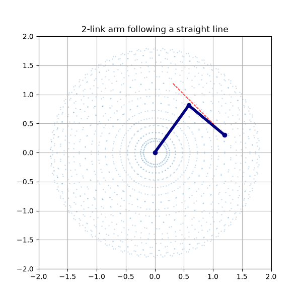

# 2-Link Arm Kinematics Simulator

A from-scratch Python implementation of forward and inverse kinematics
for a planar 2-link robot arm.

## Features so far
- Forward and inverse kinematics (elbow up and down)
- Reachability check and workspace sampling
- Straight-line trajectory animation
- Automated tests (round trip, unreachable points)

## How to run
pip install matplotlib numpy
python animate.py

## Next steps
Inverse kinematics, workspace plot, trajectory animation, Jacobian analysis.

